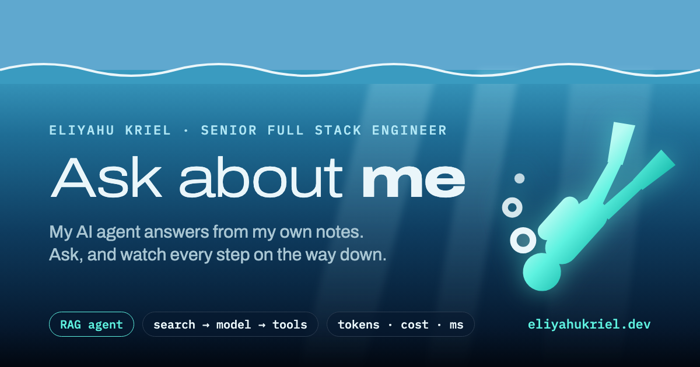
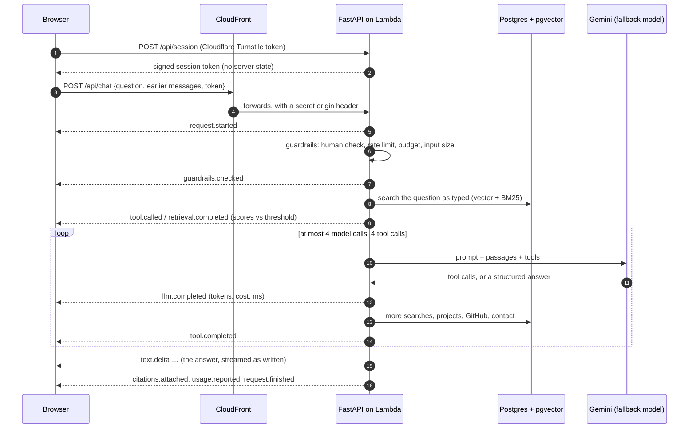
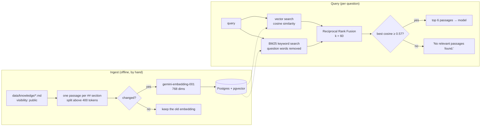
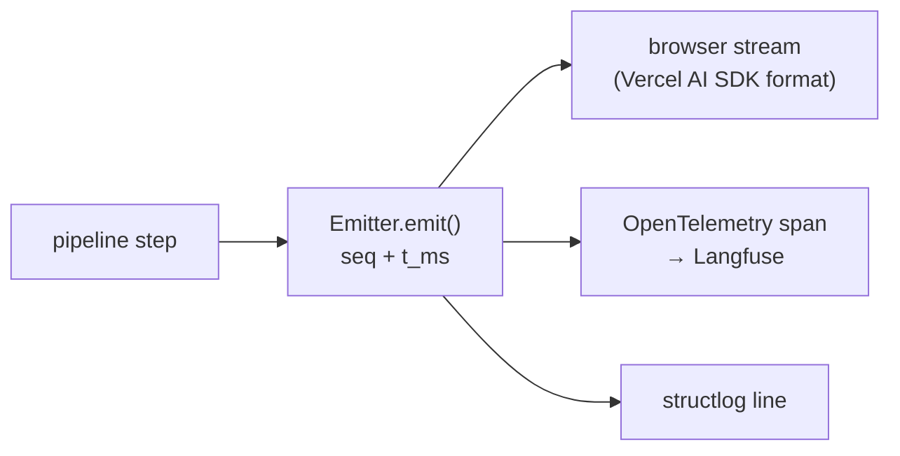
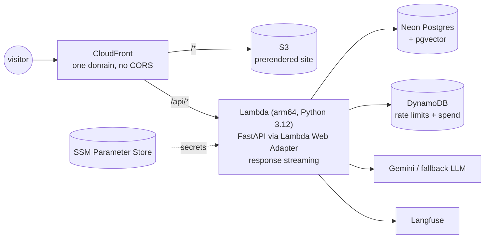

<p align="center">
  
</p>

# Ask the Deep

**[eliyahukriel.dev](https://eliyahukriel.dev)**

A personal portfolio where visitors ask an AI agent about me. It answers only from verified notes, and visitors can watch every step it takes to get there.

Most chat widgets hide the work. This one shows it. Each question becomes a dive: the diver jumps in, and every step the server takes (the guardrails, each search, each model call, each tool, the tokens, the cost, the milliseconds) appears as a card at its depth on the way down. The answer is waiting at the seabed, with its sources and a receipt.

Under the dive is an ordinary production system: retrieval-augmented generation (RAG) with measurable hallucination prevention, a bounded tool-calling agent, hard spend caps, abuse protection, tracing, and an eval suite that runs in CI.

---

## Contents

- [What happens when you ask](#what-happens-when-you-ask)
- [The RAG pipeline](#the-rag-pipeline)
- [The agent](#the-agent)
- [Keeping it honest](#keeping-it-honest)
- [The event stream](#the-event-stream)
- [The dive (frontend)](#the-dive-frontend)
- [Cost, abuse and privacy](#cost-abuse-and-privacy)
- [Observability and evals](#observability-and-evals)
- [Infrastructure](#infrastructure)
- [Stack](#stack)
- [Run locally](#run-locally)
- [Repository](#repository)
- [Decisions](#decisions)

---

## What happens when you ask



1. **Human check, once per visit.** A Cloudflare Turnstile token is traded for our own signed session token (`POST /api/session`). The server stores nothing: the signature alone proves it issued the token.
2. **Guardrails.** Before any model call, the pipeline checks the session, the rate limit (per IP and per session), the three spend caps, and the input (not empty, at most 500 characters, conversation history within limits). A failure ends the request with a clear message and no model cost.
3. **Search first.** The visitor's question is searched as typed *before* the first model call, and the model receives that result as if it had made the call itself. Most questions are answered in a single model call ([ADR 0020](docs/adr/0020-search-first-and-stream-the-answer.md)).
4. **Agent loop.** The model decides whether it needs more: another search, the project list, one project's full write-up, live GitHub activity, or contact details. Code caps the loop at 4 model calls and 4 tool calls.
5. **Answer.** The answer is structured JSON (kind, citations, text) and streams word by word. Code checks it before it counts (see [Keeping it honest](#keeping-it-honest)).
6. **Receipt.** Tokens, cost and timings go to the browser, the spend counters and the trace. The visitor's words go only to the browser.

If no valid answer comes within the limits, the visitor gets "I don't have that information" and the contact links, never a guess.

---

## The RAG pipeline



### The knowledge base

The corpus is plain markdown in [`data/knowledge/`](data/knowledge/): `profile.md`, `boundaries.md`, and folders for `experience/`, `projects/` and `skills/`. Each file has front matter, and **only files marked `visibility: public` are read**. Public files are committed; private ones are git-ignored by name ([ADR 0018](docs/adr/0018-public-knowledge-in-git.md)).

### Chunking

A passage is one `##` section of a file. A section over 400 tokens is split, and sections are never merged ([ADR 0003](docs/adr/0003-passage-size.md)). This keeps every passage a self-contained, citable unit with a stable id and a heading breadcrumb. Each source in the UI links to the file on GitHub at that heading's anchor.

### Embeddings and ingestion

`uv run python -m app.rag.ingest` reads the files, cuts them into passages, hashes each one, and embeds **only the passages that changed**. Running it twice with no edits makes no embedding calls. Embeddings are `gemini-embedding-001` at 768 dimensions ([ADR 0011](docs/adr/0011-embeddings-and-recall.md)). Publishing to the live database is a deliberate local command, never a side effect of a deploy ([ADR 0004](docs/adr/0004-local-knowledge-base.md)): `scripts/ingest.sh` runs it with `api/.env` and prints which database it writes to.

### Hybrid retrieval

Two searches run in parallel and are merged ([`app/rag/retrieval.py`](api/app/rag/retrieval.py)):

| Search | Finds | Weakness it covers |
| --- | --- | --- |
| **Vector** (pgvector, cosine) | passages with the same *meaning* in different words | keyword search misses paraphrases |
| **BM25** (`rank_bm25`) | passages sharing exact words: names, tools, companies | embeddings blur proper nouns |

The rankings are fused with **Reciprocal Rank Fusion** (`score = Σ 1 / (60 + rank)`), which needs no score calibration between the two methods. Question words ("where", "did", "he") are dropped from the BM25 query, or they match passages at random and drown out the vector ranking.

### The retrieval gate

A passage reaches the model only if the best cosine similarity clears **0.57**. That number was measured, not guessed: off-topic questions scored at most 0.53 and correct passages at least 0.62 ([ADR 0012](docs/adr/0012-retrieval-threshold.md)). Weak passages never reach the model, so the model can't build an answer on them. The dive draws this gate as the **thermocline**: the scores appear against the line, so you can see why a passage was kept or dropped.

---

## The agent

The agent ([`app/agent/chat_agent.py`](api/app/agent/chat_agent.py)) is built on [Pydantic AI](https://ai.pydantic.dev/). It is a *bounded* tool-calling agent ([ADR 0005](docs/adr/0005-bounded-tool-calling-agent.md)): the model chooses the tools, and code sets the limits.

| Tool | What it returns |
| --- | --- |
| `search_knowledge(query)` | hybrid search over the knowledge base, gated passages with citable ids |
| `list_projects()` | every project with role, technologies and link |
| `get_project(name)` | every passage of one project |
| `github_activity()` | recently updated public repositories, live (cached 10 min) |
| `contact_info()` | public contact links, offered when it can't answer |

Each tool returns text for the model plus metadata for the app. The model never sees the metadata; the pipeline turns it into events for the browser.

**Limits.** 4 model calls and 4 tool calls per question. On the last allowed call the tools are hidden, so the model must answer from what it has found instead of searching again ([ADR 0017](docs/adr/0017-answer-on-the-last-call.md)). The whole request has a 25 s deadline, under Lambda's and CloudFront's 30 s, so the visitor always gets a clear ending.

**Fallback.** If the main model fails (an HTTP error, a timeout, a dropped connection, or no answer within 8 s), the next model in `LLM_FALLBACK_MODELS` takes over. A router remembers the failure and sets that model aside for 60 s, so later visitors don't wait for it to fail again ([`app/agent/router.py`](api/app/agent/router.py)).

**Prompt.** Prompts are versioned files in [`app/agent/prompts/`](api/app/agent/prompts/) (`answer_v6.md` today). `RULES_VERSION` selects one, and every response reports the version that produced it. Gemini caches the repeated prompt prefix on its own, and the dive shows when a call hit that cache ([ADR 0015](docs/adr/0015-implicit-prompt-caching.md)).

**Languages.** Questions in Hebrew get answers in Hebrew. Names stay as written, and the output budget allows for Hebrew's 2–3× token cost ([ADR 0013](docs/adr/0013-hebrew-answers.md)). The whole UI is bilingual and RTL-first.

---

## Keeping it honest

Hallucination prevention lives in code, not only in the prompt:

- **Weak passages never reach the model.** They are stopped by the retrieval gate.
- **Citations must come from this run.** The agent records every passage a tool returned. A cited id that no tool returned is dropped from the answer.
- **An "answered" reply needs evidence.** An answer of kind `answered` with no successful tool result fails the check. The model retries once, and after that the visitor gets "I don't have that information".
- **Off-topic questions are refused** politely, and small talk is labelled as small talk, not passed off as knowledge ([ADR 0016](docs/adr/0016-off-topic-and-question-search.md)).
- **`boundaries.md`** in the corpus lists what the agent won't discuss (salary, private life, non-public employer details, availability) and points those questions to direct contact.

All of this is measured: see [evals](#observability-and-evals).

---

## The event stream

Every step of a request is an **event**, defined once in [`api/app/events.py`](api/app/events.py) as Pydantic models:

```
request.started → guardrails.checked → [cache.checked]
→ ( llm.started → llm.completed → tool.called → retrieval.started → retrieval.completed → tool.completed )*
→ decision.made → generation.started → text.delta* → citations.attached → usage.reported → request.finished
```



- **One door.** Every event goes through `Emitter.emit` ([`app/emitter.py`](api/app/emitter.py)), which numbers it, timestamps it, and fans it out three ways. Nothing writes to the stream directly.
- **One schema, two languages.** The TypeScript types in `web/src/generated/events.gen.ts` are generated from the Python models (`pnpm gen:events`), so the API and the UI can't drift apart.
- **Standard wire format.** [`app/stream.py`](api/app/stream.py) writes the Vercel AI SDK UI message stream: the answer as text parts, and every other event whole as a `data-event` part. The site uses `useChat` from `@ai-sdk/react`, and each answer carries the full record of how it was made.
- **The dive and the trace agree.** A gate test ([`app/trace_gate.py`](api/app/trace_gate.py)) asks real questions and checks that the Langfuse trace has exactly the stages the dive showed, with the same tokens and cost.

---

## The dive (frontend)

The site ([`web/`](web/)) is TanStack Start, prerendered to static HTML and served from S3. The home page is one full-screen [three.js](https://threejs.org/) sea behind real, accessible DOM ([ADR 0010](docs/adr/0010-sea-dive-ui.md)).

- **Depth is the process view.** Each stage is a zone of the sea and each event is a step card at its depth. The retrieval gate is the thermocline. The light fades and the palette darkens as you go down.
- **The giant stride.** Before a dive, the diver holds up a slate with the question and a short buddy check (what travels with the request, and that nothing is stored). On "Jump in" he takes a giant stride off the boat. The question is sent at the jump, so the server works while he is in the air ([ADR 0021](docs/adr/0021-giant-stride.md)).
- **Paced playback.** The server usually finishes in 1–3 s, far faster than anyone can read. The dive replays the real events at about 30 s per question, with Pause, 2× and Skip. Every time shown is the server's real time ([ADR 0019](docs/adr/0019-dive-v3.md)).
- **At the seabed** the answer arrives with its sources, a dive profile and a receipt (tokens, cost, model calls). Every answer can replay its dive.
- **Stay at the surface** answers without the dive, for visitors who just want the text.
- **The conversation lives in the browser** (`sessionStorage`) and is sent with each question. The server stays stateless ([ADR 0007](docs/adr/0007-session-history-in-the-browser.md)).
- **The models** are 24 CC BY / CC0 glTF files, compressed with meshopt and WebP to 8 MB in total, 1.4 MB before the first question. They load zone by zone as you dive, and the page credits every one.
- **Accessibility.** Keyboard paths throughout, a live region announces the result, reduced motion skips the leap, and without WebGL the dive starts at once.
- **Security.** A strict Content Security Policy with hashes for inline scripts is written into every prerendered page at build time ([`web/scripts/apply-csp.ts`](web/scripts/apply-csp.ts)).

---

## Cost, abuse and privacy

**Spend caps** ([ADR 0008](docs/adr/0008-five-dollars-a-month.md)). The site stops answering before it can cost more than allowed. Three counters in DynamoDB, kept in micro-dollars so the sums stay exact, are checked before every question and charged with its real cost afterwards:

| Cap | Limit |
| --- | --- |
| Month (hard limit) | $5.00 |
| Day | $0.50 |
| Visitor per day | $0.05 |

Costs are computed from the token usage with [`genai-prices`](https://github.com/pydantic/genai-prices), at paid list prices even on the free tier ([ADR 0006](docs/adr/0006-prices-from-genai-prices.md)).

**Abuse.** Turnstile proves a human once per visit, and the rate limit is 5 questions a minute per IP and per session. Input and history are size-capped. In production the API refuses any request that lacks CloudFront's secret origin header.

**Privacy.** Conversation text is never stored: not in logs, not in traces, not in a database. Visitor IPs are salted and hashed. Values derived from the question are masked in logs, no span carries Langfuse's input/output attributes, and errors log only the exception type and HTTP status, because provider messages can echo the conversation. A dedicated test suite ([`tests/test_privacy.py`](api/tests/test_privacy.py)) enforces this.

---

## Observability and evals

**Tracing.** Each request is an OpenTelemetry trace exported to Langfuse: one span per stage (guardrails, each model call, each tool call), built from the same events the visitor sees. Logs are structured JSON with `structlog`. A public `/api/stats` endpoint serves the aggregate numbers.

**Answer evals** ([`app/evals/run.py`](api/app/evals/run.py)). A golden set of 49 cases ([`evals/golden.yaml`](api/evals/golden.yaml)) runs through the full pipeline with [Pydantic Evals](https://ai.pydantic.dev/evals/) and is graded two ways:

- **in code:** the answer kind is one the case accepts, it cites an expected passage, it cites only passages a tool returned, and it used the right tools and no unneeded ones;
- **by a judge model** ([`app/agent/judge.py`](api/app/agent/judge.py)): required facts present, forbidden claims absent, every statement about me grounded in the returned passages.

The run fails below an 85% pass rate, or on any blocker: a trap question answered with a guess, or a citation no tool returned.

**Retrieval evals.** Recall@k over [`evals/retrieval.yaml`](api/evals/retrieval.yaml) must stay at or above 0.9.

**CI** (GitHub Actions):

| Workflow | When | What |
| --- | --- | --- |
| `ci.yml` | every push and PR | Ruff, mypy strict, pytest, Biome, `tsc`, vitest |
| `evals.yml` | changes to the agent, RAG, prompts or corpus; nightly | ingest into a throwaway Postgres, run the evals |
| `deploy.yml` | after CI passes on `main` | Lambda zip + S3 sync + CloudFront invalidation, then a health check |

Tests never call a paid API: they use Pydantic AI's `TestModel` and the `"test"` model.

---

## Infrastructure



- **Pay-per-use only.** No server runs while nobody visits: S3, CloudFront, Lambda, DynamoDB on-demand, Neon serverless. Terraform in [`infra/`](infra/).
- **One domain for site and API**, so the browser never needs CORS. The DNS is at Cloudflare and the ACM certificate is in us-east-1.
- **Streaming on Lambda.** A Lambda function URL with `RESPONSE_STREAM` and the [Lambda Web Adapter](https://github.com/awslabs/aws-lambda-web-adapter) runs plain uvicorn, so the same FastAPI app serves locally and in production.
- **Secrets** live in SSM, per environment, never in the repo ([ADR 0014](docs/adr/0014-secrets-per-environment.md)). No Redis: DynamoDB holds the counters ([ADR 0002](docs/adr/0002-no-redis.md)).

---

## Stack

| Layer | Choice |
| --- | --- |
| API | Python 3.12, FastAPI, Pydantic AI, server-sent events, uv |
| Models | Google Gemini (`gemini-3.5-flash-lite`), a fallback chain, `gemini-embedding-001` |
| Retrieval | Postgres + pgvector (Neon), BM25, merged with RRF |
| Web | TanStack Start (static prerender), React 19, TypeScript, Tailwind, shadcn/ui on Radix, three.js, Vercel AI SDK |
| Infra | AWS S3 + CloudFront, Lambda with response streaming, DynamoDB, SSM, Terraform |
| Observability | OpenTelemetry → Langfuse, structlog |
| Quality | Ruff, mypy strict, Biome, pytest, vitest, Playwright + axe, Pydantic Evals, pre-commit |

---

## Run locally

Requirements: [uv](https://docs.astral.sh/uv/), Node 22 with pnpm, and Docker.

```sh
./scripts/dev.sh
```

This starts Postgres (pgvector) and DynamoDB Local in Docker, the API on http://localhost:8000, and the site on http://localhost:5173 (which proxies `/api` to the API). Ctrl-C stops the API and the site; `docker compose down` stops the databases.

The API runs on the free built-in `"test"` model, so no keys are needed. Ask it a question:

```sh
curl -N -X POST localhost:8000/api/chat \
  -H 'content-type: application/json' \
  -d '{"question": "Which technologies does Eliyahu work with daily?"}'
```

To use a real model, copy `api/.env.example` to `api/.env` and set `GOOGLE_API_KEY`. Every tunable value (model, thresholds, limits, caps) is an environment variable in [`api/app/config.py`](api/app/config.py).

### Checks

```sh
cd api && uv run ruff format . && uv run ruff check . && uv run mypy app tests && uv run pytest
cd web && pnpm exec biome check --write . && pnpm exec tsc --noEmit && pnpm test
```

Pre-commit runs them before each commit: `uvx pre-commit install`.

### Evals (real model calls)

```sh
cd api
uv run --env-file .env python -m app.evals.run --quick   # 8 cases, about 4 minutes
uv run --env-file .env python -m app.evals.run           # the full golden set
```

---

## Repository

Each major folder has its own README with the details:

| Folder | README covers |
| --- | --- |
| [`api/`](api/) | routes, every module, the agent's guarantees, configuration, tests, evals |
| [`web/`](web/) | the question-to-dive data flow, the three.js scene, design system, accessibility, SEO |
| [`infra/`](infra/) | every AWS resource, alerts, environments, how to apply |
| [`data/`](data/) | the knowledge-base format and how to publish a change |
| [`docs/adr/`](docs/adr/) | an index of every architecture decision |

```
api/
  app/
    main.py          HTTP routes: /api/session, /api/chat, /api/stats, /api/health
    pipeline.py      one question, from guardrails to the last event
    events.py        the event schema (source of truth for the UI types)
    emitter.py       numbers events, fans them out to stream, trace and logs
    stream.py        Vercel AI SDK stream format
    agent/           the model layer: agent loop, tools, router, judge, prompts
    rag/             corpus, chunking, embeddings, ingest, hybrid retrieval
    control/         Turnstile sessions, rate limit, spend caps, stats
    evals/           golden-set runner
  evals/             golden.yaml, retrieval.yaml
  tests/
web/
  src/
    routes/          pages (TanStack file routes)
    components/      React components (ui/ is shadcn)
    hooks/           React hooks; hooks/sea/ builds the three.js scene
    utils/ types/ constants/
    generated/       events.gen.ts, generated from api/app/events.py
  public/            favicon, Open Graph image, 3D models
  scripts/           CSP and model compression build steps
data/knowledge/      the markdown knowledge base (visibility: public only)
infra/               Terraform
docs/adr/            architecture decision records
scripts/             dev.sh, deploy.sh
```

---

## Decisions

Every decision that departs from the original spec has a short record in [`docs/adr/`](docs/adr/) ([index](docs/adr/README.md)). A few that shaped the system:

- [0005](docs/adr/0005-bounded-tool-calling-agent.md) A bounded tool-calling agent instead of a fixed pipeline
- [0008](docs/adr/0008-five-dollars-a-month.md) Spend capped at $5 a month
- [0010](docs/adr/0010-sea-dive-ui.md) Sea dive UI: depth is the process view
- [0012](docs/adr/0012-retrieval-threshold.md) Retrieval threshold 0.57, set from measured scores
- [0020](docs/adr/0020-search-first-and-stream-the-answer.md) Search first, stream the answer, think minimally

More: [task tracker](TASKS.md) · [project conventions](CLAUDE.md)
