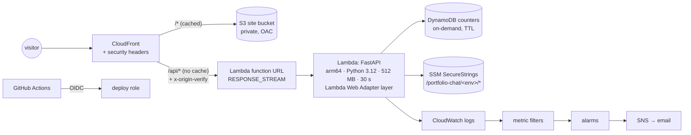

# infra

All AWS infrastructure in one Terraform file, [`main.tf`](main.tf). Every resource is pay-per-use, so nothing costs money while nobody visits, and the whole thing stays under the $5/month budget ([ADR 0008](../docs/adr/0008-five-dollars-a-month.md)).

For the big picture, see the [root README](../README.md).

## What it builds



| Area | Resources | Notes |
| --- | --- | --- |
| **Site** | S3 bucket, public access block, CloudFront origin access control, bucket policy | Only CloudFront can read the bucket |
| **API** | Lambda function + function URL, IAM role, log group | Streams responses through the [Lambda Web Adapter](https://github.com/awslabs/aws-lambda-web-adapter), which runs plain uvicorn |
| **CDN** | CloudFront distribution, response headers policy | One domain for site and API (no CORS). Adds HSTS, `frame-ancestors 'none'`, `X-Frame-Options: DENY`, `nosniff`, Referrer-Policy, Permissions-Policy, COOP |
| **Origin lock** | `random_password` → secret header | CloudFront sends it on every API request; the API refuses requests without it, so the function URL can't be called directly |
| **Counters** | DynamoDB table `pk` + TTL `expires_at` | Rate limits and spend caps; old counters expire on their own ([ADR 0002](../docs/adr/0002-no-redis.md)) |
| **Secrets** | SSM `SecureString` parameters | Created as `CHANGE_ME`. Real values are set by hand and Terraform ignores them, so they never touch state or the repo ([ADR 0014](../docs/adr/0014-secrets-per-environment.md)) |
| **Domain** | ACM certificate (us-east-1) + validation | Custom domain per workspace; DNS lives at Cloudflare |
| **Budget** | AWS Budgets monthly budget | Emails `budget_email` when AWS spend crosses the budget |
| **Alerts** | Log metric filters, CloudWatch alarms, SNS topic + email | See below |
| **CI** | IAM role for GitHub OIDC | Only `main` of the configured repo can assume it; it may update the Lambda code, sync the bucket and invalidate CloudFront |

The Lambda is created with a tiny placeholder ([`placeholder/`](placeholder/)). The real code is uploaded by [`scripts/deploy.sh`](../scripts/deploy.sh), so Terraform never has to build Python.

## Alerts

The API writes structured JSON logs. Metric filters turn them into CloudWatch metrics under `PortfolioChat/<env>`:

| Alarm | Fires when |
| --- | --- |
| `budget-80` | a spend cap (day or month) passes 80% |
| `errors` | `alert_errors` (3) questions end in an error within 15 minutes |
| `slow` | the average answer time over 15 minutes exceeds `alert_latency_ms` (15 s) |

## Environments

Environments are Terraform **workspaces**. The workspace name sets the resource names (`portfolio-chat-<env>`), the SSM prefix (`/portfolio-chat/<env>/`) and the custom domain (`staging` → `eliyahukriel.dev`; others use the `cloudfront.net` address). State is shared in a versioned S3 bucket with native locking, so CI and a laptop see the same state.

## Applying

Infrastructure changes are applied by hand. CI only deploys code.

```sh
cd infra
terraform init
terraform workspace select staging        # or: terraform workspace new <env>
terraform plan -var budget_email=you@example.com
terraform apply -var budget_email=you@example.com
```

First apply of a new environment:

1. `terraform apply`. With a custom domain, it waits on certificate validation: add the records from the `certificate_dns` output at Cloudflare.
2. Set each secret in SSM: `aws ssm put-parameter --overwrite --type SecureString --name /portfolio-chat/<env>/GOOGLE_API_KEY --value …`. The secrets are `DATABASE_URL`, `GOOGLE_API_KEY`, `OPENAI_API_KEY`, `TURNSTILE_SECRET_KEY`, `LANGFUSE_PUBLIC_KEY`, `LANGFUSE_SECRET_KEY`, `IP_HASH_SALT` and `SESSION_SECRET`.
3. Deploy the code: `scripts/deploy.sh <api_function_name> <site_bucket> <distribution_id>`, using the outputs below.
4. Ingest the knowledge base into that environment's database: `DATABASE_URL=… uv run python -m app.rag.ingest` from `api/` ([ADR 0004](../docs/adr/0004-local-knowledge-base.md)).

## Variables

| Variable | Default | Meaning |
| --- | --- | --- |
| `region` | `eu-central-1` | Everything except the certificate |
| `budget_email` | required | Where budget and alarm emails go |
| `monthly_budget_usd` | `5` | AWS Budgets threshold |
| `alert_errors` | `3` | Errors per 15 minutes that raise an alarm |
| `alert_latency_ms` | `15000` | Average latency that raises an alarm |
| `lambda_concurrency` | `-1` | Reserved concurrency cap (-1 = none) |
| `llm_model`, `llm_fallback_models`, `embedding_model` | see `main.tf` | Passed to the Lambda as environment variables |
| `github_subject` | this repo, by immutable owner and repo ids | The only repo whose `main` may assume the deploy role |
| `lwa_layer_version` | see `main.tf` | Lambda Web Adapter layer version |

## Outputs

`site_url`, `site_bucket`, `distribution_id`, `api_function_name`, `counters_table`, `deploy_role_arn`, and `certificate_dns` (the validation records to add at Cloudflare).
