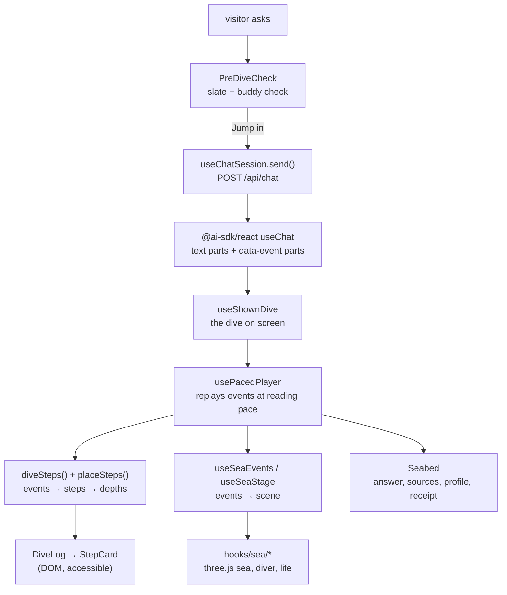

# web

The site: a single page where a question becomes a dive through a three.js sea, and every server event becomes a step card at its depth. TanStack Start, prerendered to static HTML, React 19, TypeScript strict, Tailwind, shadcn/ui on Radix. Managed with pnpm.

For the big picture, see the [root README](../README.md).

## Quick start

```sh
pnpm install
pnpm dev            # http://localhost:5173, proxies /api to localhost:8000
```

The API has to be running for questions to work (`../scripts/dev.sh` starts both).

| Command | What it does |
| --- | --- |
| `pnpm dev` | Vite dev server on port 5173 |
| `pnpm build` | Prerender to `dist/client`, then write the CSP into every page |
| `pnpm test` | vitest unit and component tests |
| `pnpm test:e2e` | Playwright dive tests, desktop and mobile, with axe accessibility checks |
| `pnpm gen:events` | Regenerate `src/generated/events.gen.ts` from `api/app/events.py` |
| `pnpm exec biome check --write .` | Format and lint |
| `pnpm exec tsc --noEmit` | Type-check |

## From question to dive



1. **Session.** `useSession` runs the Cloudflare Turnstile check once (`HumanCheck`) and keeps the signed session token in browser storage.
2. **Pre-dive.** `PreDiveCheck` shows the question on a diver's slate with a short buddy check: what travels with the request, and that nothing is stored. The question is sent as the diver jumps, so the server is already working while he is in the air.
3. **Streaming.** `useChatSession` wraps `useChat` with a `DefaultChatTransport`. The answer arrives as text parts; every other server event arrives as a `data-event` part and stays on the message, so each answer keeps its full record. The thread is saved to `sessionStorage` and sent as `history` with the next question.
4. **Pacing.** The server usually finishes in 1–3 s. `usePacedPlayer` replays the real events at about 30 s per question, with pause, 2× and skip. The times shown are always the server's real times.
5. **Placing.** `utils/depth.utils.ts` turns events into steps (guardrails, each model call, each tool, the retrieval gate, the answer) and gives each one a depth. A step is never placed above the one before it. `useDiveLayout` measures the cards, and `useDiveFollow` keeps the camera on the current one.
6. **The scene follows.** `useSeaEvents` maps events to the sea: the diver's lamp is on while the model thinks, a search sends out a sonar ping, retrieved passages light up as lanterns against the threshold, and streamed words release bubbles. `useSeaStage` moves the diver and camera between rest, dive, seabed and ascent.
7. **The seabed.** `Seabed` shows the dive profile, the receipt (tokens, cost, model calls) and a replay button. The chat comes back with the answer and its sources.

"Stay at the surface" (`useProcessPreference`) skips all of this and simply answers.

## Source layout

Each file holds one kind of thing: a component, a hook, a function module, types or constants ([CLAUDE.md](../CLAUDE.md#frontend)).

```
src/
  routes/          __root.tsx (document, SEO head), index.tsx (the page)
  components/      render only: Chat, DiveLog, StepCard, Seabed, ServerPanel, PreDiveCheck, …
  components/ui/   shadcn/ui on Radix (Button, Badge, Switch, DropdownMenu)
  hooks/           state and effects: chat, session, pacing, layout, scroll, scene wiring
  hooks/sea/       the three.js scene, one part per file (stateful builders, not hooks)
  utils/           pure functions, <name>.utils.ts, all unit-tested
  types/           interfaces and types, <name>.types.ts
  constants/       constants and UI copy (English + Hebrew), <name>.constants.ts
  generated/       events.gen.ts, never edited by hand
  styles.css       design tokens and global styles
public/            favicon, Open Graph image, robots.txt, sitemap.xml, 3D models
scripts/           build steps: CSP injection, model compression
tests/             mirrors src/; fixtures/ holds a captured SSE stream
```

### The sea (`src/hooks/sea/`)

Plain three.js, no React Three Fiber ([ADR 0009](../docs/adr/0009-glass-box-ui.md)). `useSea` calls `createSea`, which assembles the parts:

| Part | What it builds |
| --- | --- |
| `sky`, `ocean`, `water` | the sky, the animated swell, the water colour by depth zone |
| `lights`, `shafts`, `glow`, `particles` | sunlight, god rays, bioluminescent glow, marine snow |
| `diver`, `splash` | the rigged diver (giant stride, head-down dive) and the entry splash |
| `life`, `spawn`, `pool`, `models` | sea life placed by depth zone, loaded zone by zone and reused |
| `seabed`, `markers`, `zone` | the seabed, depth markers, the current zone |

Tuning lives in `constants/seaScene.constants.ts`, and the maths in `utils/`, so it can be tested without WebGL. The 24 glTF models in `public/models/` are CC BY or CC0. They are compressed with meshopt and WebP (8 MB in total, 1.4 MB before the first question), and `ModelCredits` credits each one.

## Design system

- **Tokens** are CSS variables in [`src/styles.css`](src/styles.css): deep-water surfaces, a bioluminescent accent (`--color-accent: #5ef2e0`), and a sea palette by depth zone. There are no hard-coded colours in components.
- **One palette, set by depth.** There's no theme switch: the surface is light, the deep is dark ([ADR 0010](../docs/adr/0010-sea-dive-ui.md)).
- **Type.** Archivo (variable width) for everything, wide for display. Heebo carries Hebrew. IBM Plex Mono for numbers and labels only. All self-hosted.
- **RTL-first.** Logical properties only (`ms-*`, `ps-*`, `inset-inline`). The page flips to `dir="rtl"` for Hebrew.
- **Motion.** CSS and WAAPI, no motion library. Reduced motion skips the leap and the long transitions.

## Accessibility

- The scene is decoration; everything you can read or use is real DOM.
- Keyboard paths for the whole dive: Esc cancels the pre-dive, focus moves to the answer at the seabed.
- A polite live region announces the result.
- Without WebGL, the dive starts at once.
- `pnpm test:e2e` runs axe on desktop and mobile.

## SEO and security

- `routes/__root.tsx` writes the title, description, canonical URL, Open Graph and Twitter cards, `theme-color` and a schema.org `Person` (JSON-LD) from [`constants/seo.constants.ts`](src/constants/seo.constants.ts).
- `public/` holds `favicon.svg` (with `favicon.ico` and PNG fallbacks), `site.webmanifest`, `og.png` (1200×630), `robots.txt` and `sitemap.xml`.
- `scripts/apply-csp.ts` adds a Content-Security-Policy `<meta>` to every prerendered page, with a SHA-256 hash for each inline script. CloudFront adds HSTS, `frame-ancestors 'none'` and the other security headers.

## Tests

- **Unit** (`tests/utils/`): every util, including the pacing clock, the depth placement, stream-word splitting and the dive profile.
- **Component** (`tests/components/`): DiveLog, Seabed, ServerPanel, ThreadTurn and AnswerMarkdown, fed from `tests/fixtures/chat-stream.sse`, a captured real stream.
- **End to end** (`tests/e2e/`): a full dive in Playwright on desktop and mobile, with software WebGL so it runs without a GPU. `E2E_BASE_URL` points it at a deployed site.
